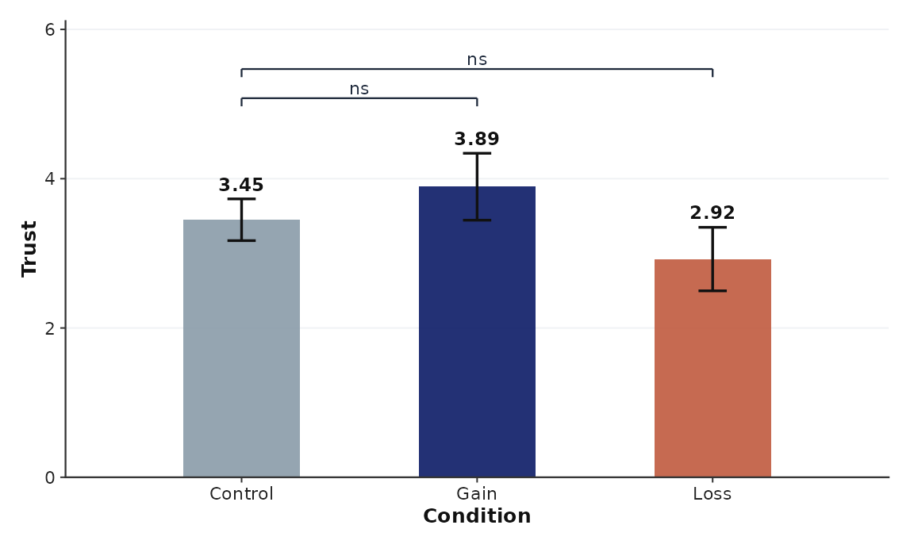
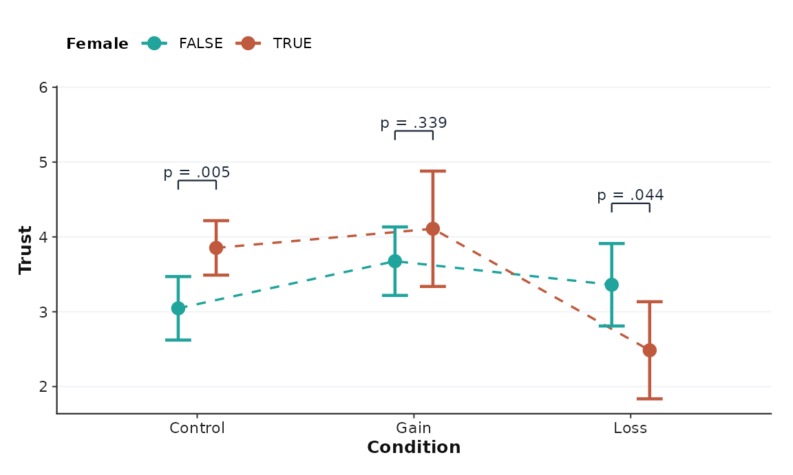
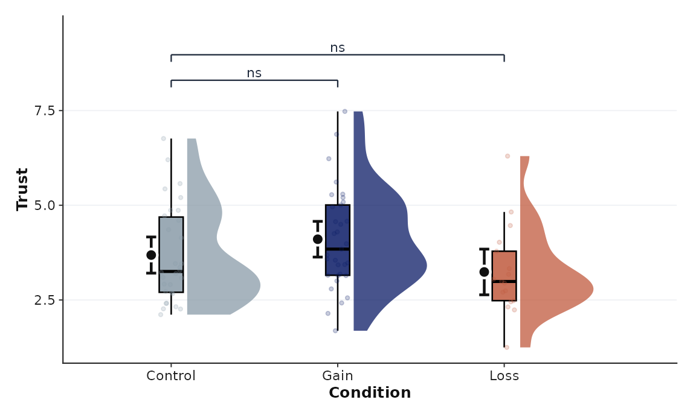
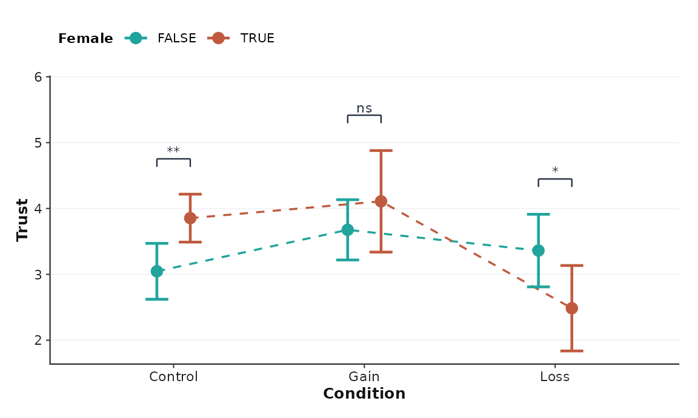
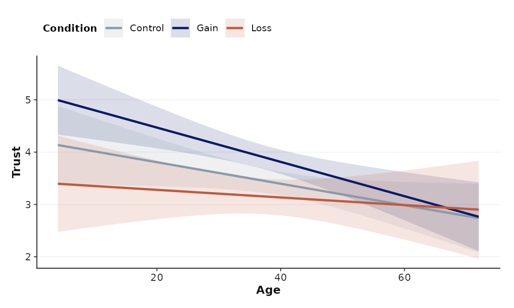
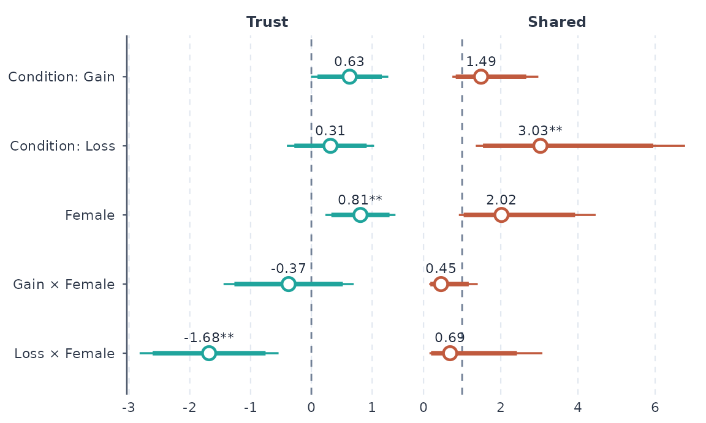
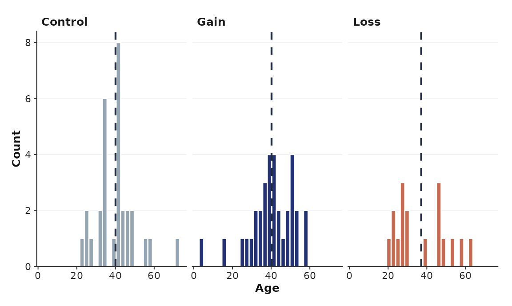

# Figures

Every plot is an ordinary ggplot, so `+ labs()`, `+ facet_wrap()`,
`+ theme()` and any other layer work. The default look is a
Nature/Science-style theme with a colour-vision-checked palette and
journal column widths.

``` r

library(cleanresults)

d <- cr_example_data()
p <- d[!duplicated(d$id), ]       # one row per person, for raw-data plots

res <- clean_regress(
  d,
  dvs = c(trust = "linear", share = "logistic"),
  predictors = ~ condition * female,
  random = ~ (1 | id),
  contrasts = "condition",
  dv_labels = c(trust = "Trust", share = "Shared")
)
#> Registered S3 method overwritten by 'clubSandwich':
#>   method    from    
#>   bread.mlm sandwich
```

## Group means with significance brackets

From a fitted model, the means are estimated marginal means with the
model’s own (robust) SEs, and the brackets use the same adjusted
contrasts as the table, so a star on the figure always matches the table
and text.

``` r

cr_plot_means(res, "trust", "condition")
```



``` r

cr_plot_means(res, "trust", "condition", by = "female", type = "dot", p = "value")
```



From a data frame you get raw means with SE, SD, or CI and Welch
*t*-test brackets (Holm-adjusted by default):

``` r

cr_plot_means(p, "trust", "condition", type = "raincloud")
```



Brackets: `comparisons = "ref"` (versus the first level), `"all"`,
`"sig"`, or named pairs; `p = "stars"`, `"value"`, or `"none"`.
*P*-values always come from the full set of pairs, so showing fewer
brackets never changes them.

## Interactions

``` r

cr_plot_interaction(res, "trust", "condition", "female")
```



With a continuous variable on the x axis you get predicted lines and
ribbons:

``` r

res_age <- clean_regress(d, dvs = c(trust = "linear"),
                         predictors = ~ condition * age)
cr_plot_interaction(res_age, "trust", "age", "condition")
```



## Coefficients and distributions

The forest plot has a thick 90% interval inside the thin 95% interval,
and a dashed line at no effect.

``` r

cr_plot_coef(res)
```



``` r

cr_plot_hist(p, "age", by = "condition")
```



## Captions, themes, colours, export

Every plot carries a method note for the caption:

``` r

g <- cr_plot_means(res, "trust", "condition") + ggplot2::labs(title = "Study 1")
attr(g, "cr_note")
#> [1] "Bars show model-estimated marginal means (Linear mixed; CR2 cluster-robust SEs clustered by ID with Satterthwaite df). Error bars show 95% confidence intervals. Brackets show pairwise model contrasts, Holm-adjusted across all pairs. * p < .05, ** p < .01, *** p < .001; ns = not significant."
```

- **Themes:** `theme_cr("nature")` (default), `"psychsci"`, `"jcr"`,
  `"polsci"`. Pass `style =` to any plot, or add
  [`theme_cr()`](https://shayemcd.github.io/clean-results/reference/theme_cr.md)
  to your own.
- **Colours:** `cr_palette(n)` picks validated defaults (2 groups: teal,
  terracotta; 3: slate control, navy, terracotta; 4: navy, teal,
  terracotta, purple). Every pair in them stays distinguishable for
  colour-blind readers. Slate and teal are almost identical for
  red-blind readers, so avoid using them together. Other palettes:
  `"teal_terracotta"`, `"forest_lilac"`, `"nordic_ochre"`,
  `"partisan_bridge"`. Set one project-wide with
  `options(cleanresults.palette = "forest_lilac")`, or use
  [`scale_fill_cr()`](https://shayemcd.github.io/clean-results/reference/scale_fill_cr.md).
- **Export:** `.pdf` (vector, fonts embedded via cairo), `.svg`, `.eps`,
  and `.png`/`.tiff` at 600 dpi. `width` takes millimetres or `"1col"`
  (88 mm), `"1.5col"`, and `"2col"` (178 mm).

``` r

cr_save(g, file.path(tempdir(), "fig1.pdf"), width = "1col")
cr_palette(3)
#> [1] "#8A9BA8" "#0B1B66" "#C05A3E"
```
